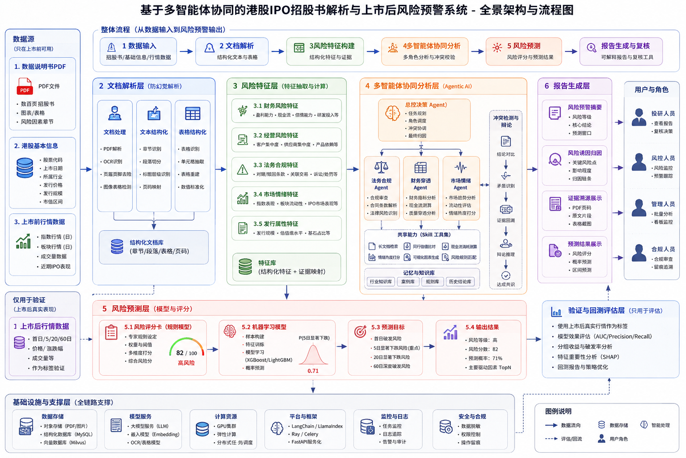

# ProspectAlpha

ProspectAlpha 是一个面向港股 IPO 的可解释 RiskAgent 系统，用于招股书解析与上市后下行风险预警。项目目标是将 IPO 招股书、公司基础信息和上市前市场信号转化为有证据支撑的风险特征、多智能体分析日志、预测结果和可复核报告。

> 当前状态：架构骨架阶段。本仓库已经定义目标系统边界、后端模块划分和协作规则；生产级风险分析能力尚未实现。



## 项目要解决什么问题

ProspectAlpha 关注一个核心问题：

> 在港股 IPO 上市前，能否识别短期显著下跌或破发风险较高的公司，并用可追溯证据解释风险原因？

本系统不是黑箱股价预测器。它更强调让风险分析过程可解释、可审计、可复核：

- 每个风险结论都应能回溯到招股书原文证据；
- 每个智能体判断都应留下执行与分析轨迹；
- 每个预测结果都应由结构化特征和可复核评分逻辑支撑；
- 每份报告都应支持投研、风控和合规人员进行人工复核。

## 系统架构

ProspectAlpha 采用从数据源到风险报告的分层流水线架构。

| 层级 | 职责 |
| --- | --- |
| 数据源 | 招股书 PDF、港股基础信息、上市前行情数据，以及用于评估的上市后标签。 |
| 文档解析 | PDF 解析、OCR、页面清洗、章节识别、段落切分、表格抽取和页码映射。 |
| 证据库 | 结构化文本块、表格、页码、截图和检索元数据。 |
| 风险特征 | 财务、经营、法务合规、市场情绪和发行属性等风险信号。 |
| 多智能体分析 | 总控、财务、法务、业务、市场、验证和报告智能体协同完成风险推理。 |
| 风险预测 | 优先采用规则评分卡，后续支持机器学习模型进行风险概率校准和排序。 |
| 报告生成 | 风险摘要、核心诱因、证据溯源、Agent 日志和人工复核输出。 |
| 回测评估 | 历史回测、标签对比、AUC/Precision/Recall、分组收益分析和特征重要性分析。 |

后端骨架在 `backend/src/riskagent/` 下与上述架构保持一致：

```text
backend/src/riskagent/
├── ingestion/     # 数据接入
├── parsing/       # 招股书结构化解析
├── retrieval/     # 证据库与混合检索
├── features/      # 风险特征抽取
├── agents/        # 多智能体协同边界
├── skills/        # 可复用 Agent Skill
├── prediction/    # 规则评分卡与后续模型服务
├── backtesting/   # 回测评估与历史验证
├── reporting/     # Markdown / HTML / PDF 报告生成
├── api/           # FastAPI 路由边界
└── common/        # 配置、日志、异常和稳定类型
```

## 项目优势

### 证据优先的风险分析

IPO 风险结论只有在复核人员能看到原始依据时才有价值。ProspectAlpha 围绕证据可追溯性设计：页码、章节、文本块、表格、bbox 和截图元数据都是一等输出，而不是报告生成后的附属信息。

### 多智能体复核，而不是单次摘要

系统按专业视角拆分风险推理：

- 财务 Agent 关注收入质量、现金流、毛利率、研发投入和持续经营压力；
- 法务 Agent 关注诉讼、合规、关联交易、特殊股东权利等条款风险；
- 业务 Agent 关注客户集中度、供应商依赖、产品结构和商业化风险；
- 市场 Agent 关注发行窗口、流动性、可比 IPO 表现和市场情绪；
- 验证 Agent 负责检查风险结论是否被证据充分支撑，并处理冲突判断。

这种拆分方式让系统更容易审计、测试，也便于多人按模块持续改进。

### 结构化信号与非结构化理解结合

招股书风险分析既需要数值特征，也需要基于原文的语义理解。ProspectAlpha 将以下能力组合在一起：

- 来自公司基础信息和市场数据的结构化字段；
- 从招股书中解析出的文本和表格；
- 面向证据定位的混合检索；
- 面向 MVP 的透明规则评分卡；
- 后续用于排序、校准和回测的机器学习模型。

### 面向人工复核设计

系统的最终使用者不只是算法调用方。投研人员、风控人员、管理人员和合规人员需要从不同视角查看同一条风险链路。因此架构中显式保留了报告生成、证据展示、Agent 日志和复核意见等层级。

### 适合多人协作的模块边界

仓库按模块组织，便于不同角色并行开发：

- 数据工程师负责数据接入和文档解析；
- 检索工程师负责证据索引和混合检索；
- 风险分析人员维护风险 taxonomy 和特征规则；
- Agent 工程师负责智能体编排和 Skill 设计；
- 后端工程师负责稳定 API 和任务边界；
- 数据科学人员负责评分卡、模型和回测评估。

仓库级协作规则见 `AGENTS.md`。

## 计划技术栈

| 方向 | 计划技术 |
| --- | --- |
| API 服务 | FastAPI |
| 结构化数据 | PostgreSQL |
| 向量检索 | Qdrant |
| 对象存储 | MinIO 或本地文件系统 |
| 异步任务 | Celery 或 RQ |
| PDF 解析 | PyMuPDF、pdfplumber、可选 OCR |
| Agent 编排 | LangGraph 风格状态图 |
| 结构化输出 | Pydantic |
| 风险预测 | 规则评分卡优先，后续支持 LightGBM/XGBoost |
| 报告生成 | Markdown、Jinja2、HTML，后续支持 PDF 导出 |
| 部署 | Docker Compose |

## 仓库结构

```text
.
├── assets/                         # 架构图与视觉资产
├── backend/                        # RiskAgent 后端骨架
├── frontend/                       # 前端应用
├── AGENTS.md                       # 仓库级协作规则
└── HK-IPO RiskAgent 项目全链路设计说明.md
```

## 项目原则

ProspectAlpha 的价值来自可解释性，而不是看起来很自信。系统应优先给出证据充分的保守风险判断，而不是无法回溯到原始 IPO 材料的夸张结论。
