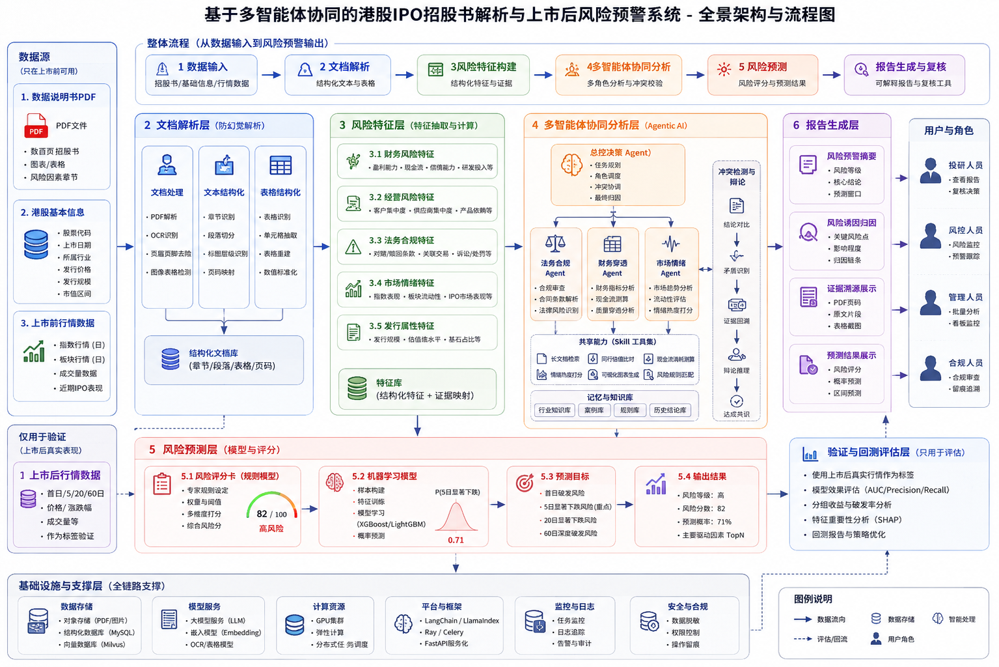

# ProspectAlpha

ProspectAlpha is an explainable HK-IPO RiskAgent system for prospectus analysis
and post-listing downside risk warning. It is designed to turn IPO documents,
company metadata, and pre-listing market signals into evidence-grounded risk
features, multi-agent review logs, prediction results, and reviewable reports.

> Current status: backend runtime in early shape. The FastAPI service,
> SQLAlchemy persistence, document ingestion, risk-rule system, analysis-run
> orchestration, and RQ worker can all run locally (see `START.md` and
> `backend/README.md`). Specialist agents, scorecard, backtesting, and report
> generation are still skeletons.



## What This Project Does

ProspectAlpha focuses on one core question:

> Before an HK IPO lists, can we identify companies with elevated short-term
> downside or break-issue risk, and explain the reasons with traceable evidence?

The system is not positioned as a black-box price predictor. Its goal is to make
risk analysis explainable, auditable, and repeatable:

- every risk conclusion should map back to prospectus evidence;
- every agent decision should leave an execution trace;
- every prediction should be supported by structured features and reviewable
  scoring logic;
- every report should support human investment, risk, and compliance review.

## Architecture

ProspectAlpha follows a layered pipeline from source data to risk report.

| Layer | Responsibility |
| --- | --- |
| Data sources | Prospectus PDFs, HK stock metadata, pre-listing market data, and post-listing labels for evaluation. |
| Document parsing | PDF parsing, OCR, page cleaning, section recognition, paragraph splitting, table extraction, and page mapping. |
| Evidence store | Structured document chunks, tables, page numbers, screenshots, and retrieval metadata. |
| Risk features | Financial, operating, legal/compliance, market sentiment, and issuance attribute signals. |
| Multi-agent analysis | Controller, financial, legal, business, market, verifier, and reporter agents collaborate on risk reasoning. |
| Risk prediction | Rule scorecard first, with future ML model support for calibrated risk probability and ranking. |
| Report generation | Risk summary, key drivers, evidence traceability, agent logs, and review outputs. |
| Evaluation | Backtesting, label comparison, AUC/precision/recall, grouped return analysis, and feature importance. |

The backend skeleton mirrors this architecture under `backend/src/riskagent/`:

```text
backend/src/riskagent/
├── api/              # FastAPI app and routes (main + risk_rules/agents/analysis_options/documents/analysis)
├── ingestion/        # Source data intake
├── parsing/          # Prospectus structure extraction
├── retrieval/        # Evidence store and hybrid retrieval
├── features/         # Risk feature extraction
├── agents/           # Multi-agent collaboration (incl. supervisor orchestration)
├── skills/           # Reusable agent skills
├── prediction/       # Scorecard and future model service
├── backtesting/      # Evaluation and historical validation
├── reporting/        # Markdown / HTML / PDF report generation
├── providers/        # embedding / object_store / vector_store abstractions
├── workers/          # Analysis task execution (inline + RQ worker)
├── database.py       # SQLAlchemy engine / session / Base
├── models.py         # ORM for 6 runtime tables
├── documents.py      # Document asset ingestion
├── analysis_runs.py  # Analysis-run state machine
├── risk_rules.py     # Risk-rule loading and CRUD
├── agent_experts.py  # Agent expert directory
└── common/           # Shared config, logging, cache, exceptions, stable types
```

## Why ProspectAlpha

### Evidence-first risk analysis

IPO risk conclusions are only useful when reviewers can inspect the original
source. ProspectAlpha is designed around evidence traceability: page number,
section, text block, table, bounding box, and screenshot metadata are first-class
outputs rather than afterthoughts.

### Multi-agent review instead of single-pass summarization

The system separates risk reasoning by professional perspective:

- financial agent for revenue quality, cash flow, margin, and R&D pressure;
- legal agent for litigation, compliance, related-party transactions, and special
  shareholder rights;
- business agent for customer concentration, supplier dependency, products, and
  commercialization risk;
- market agent for issuance window, liquidity, comparable IPOs, and market mood;
- verifier agent for evidence support and conflict checks.

This division makes analysis easier to audit, test, and improve module by module.

### Hybrid structured and unstructured intelligence

Prospectus risk analysis needs both numeric features and source-grounded language
understanding. ProspectAlpha combines:

- structured fields from company metadata and market data;
- parsed text and tables from prospectuses;
- hybrid retrieval for evidence lookup;
- rule-based risk scoring for transparent MVP behavior;
- future ML models for ranking, calibration, and backtesting.

### Designed for human review

The final user is not only an algorithm consumer. Investment analysts, risk
reviewers, managers, and compliance users need different views of the same risk
chain. The architecture therefore keeps report generation, evidence display,
agent logs, and review comments as explicit system layers.

### Collaboration-friendly module boundaries

The repository is organized so multiple contributors can own separate modules
without stepping on each other:

- data engineers can work on ingestion and parsing;
- retrieval engineers can work on evidence indexing;
- risk analysts can maintain taxonomy and feature rules;
- agent engineers can work on orchestration and skills;
- backend engineers can expose stable APIs;
- data scientists can work on scorecards, models, and backtesting.

See `AGENTS.md` for repository-wide collaboration rules.

## Technology Stack

| Area | Status | Choice |
| --- | --- | --- |
| API service | Adopted | FastAPI |
| Structured data | Adopted | PostgreSQL (prod) / SQLite (default) + SQLAlchemy |
| Vector retrieval | Adopted | Qdrant (default in-memory, switchable) |
| Object storage | Adopted | MinIO or local filesystem |
| Async tasks | Adopted | RQ + Redis |
| PDF parsing | Adopted | PyMuPDF, pdfplumber, optional OCR |
| Agent orchestration | Adopted | LangGraph-style state graph |
| Structured outputs | Adopted | Pydantic |
| Deployment | Adopted | Docker Compose |
| Prediction | Planned | Rule scorecard first, future LightGBM/XGBoost |
| Reports | Partial | Markdown, Jinja2, HTML; PDF export still planned |

## Repository Layout

```text
.
├── assets/                         # Architecture diagrams and visual assets
├── backend/                        # RiskAgent backend (FastAPI + SQLAlchemy + RQ)
├── frontend/                       # Frontend application
├── AGENTS.md                       # Repository-wide collaboration rules
├── START.md                        # Local and Docker startup commands
└── README.md / README_en.md        # Project README (Chinese / English)
```

## Project Principle

ProspectAlpha should be useful because it is explainable, not because it sounds
confident. The system should prefer a lower-level risk conclusion with strong
evidence over a dramatic claim that cannot be traced back to the original IPO
materials.
